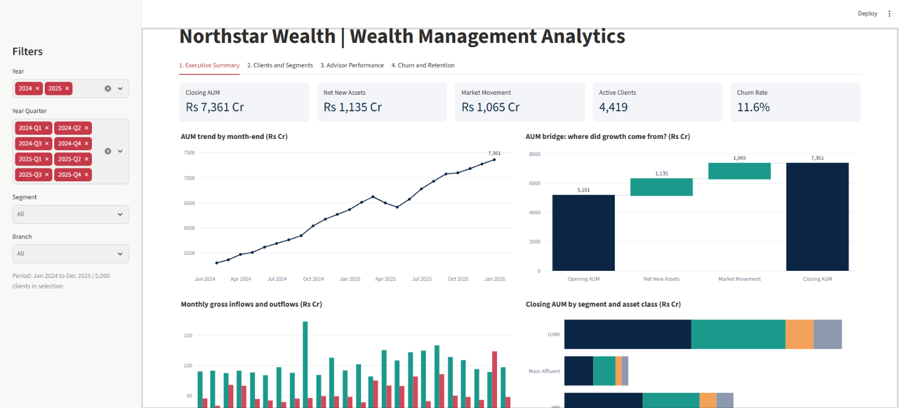
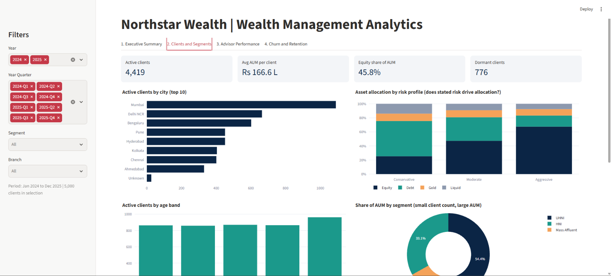
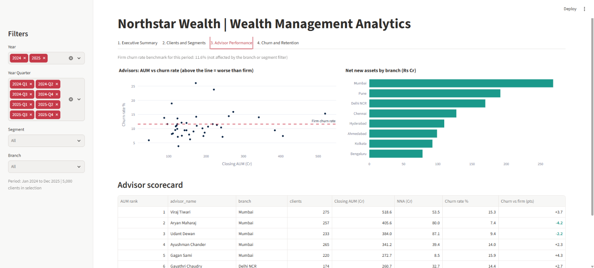
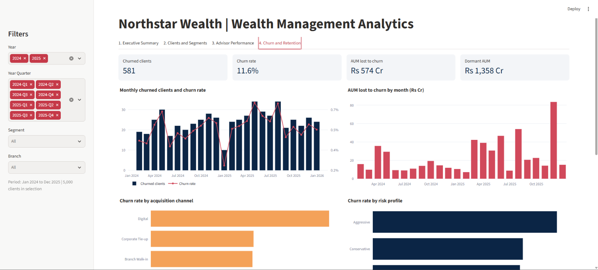

# Northstar Wealth Management Analytics

An end-to-end analytics project for **Northstar Wealth**, a fictional wealth management firm with about ₹7,360 Cr in assets under management (AUM) and 4,400+ active clients. It covers PostgreSQL data modelling, data-quality audits, 14 business-analysis queries, star-schema reporting views reconciled to 15 control totals, an automated Excel monthly report with a data-quality gate, and an interactive Streamlit dashboard. A Power BI semantic model (star schema and DAX measures) is included in `powerbi/`.

> **Important Notice on Data Authenticity:**  
> All data in this repository is **100 % synthetic**, generated deterministically using Python (`code/generate_data.py`, `SEED=42`). While modeled to mirror the exact distribution, account sizes, transaction patterns, and volatility of the Indian wealth management ecosystem (HNI/UHNI segments, SIPs, lump-sum flows, and SEBI-aligned risk profiles), no real client, advisor, or institutional data is utilized.

---

## Business Problem

Wealth management firms face structural challenges in balancing rapid client acquisition with long-term asset retention and regulatory compliance:
1. **Retention and Leaky Bucket Dynamics:** AUM growth can mask underlying client attrition and revenue erosion across disparate acquisition channels.
2. **Behavioral Volatility & Market Corrections:** Drawdowns in equity markets trigger panic redemptions, particularly among self-directed and digitally acquired clients.
3. **Account Dormancy & Hidden Revenue Leakage:** Substantial assets sit in unmanaged, stagnant accounts with no recent advisory engagement, signaling imminent departure.
4. **Portfolio Suitability & Concentration Risk:** Massive capital concentration among top-tier accounts, combined with asset allocation drift (e.g., conservative clients overexposed to volatile equities), exposes the firm to severe compliance and liquidity vulnerabilities.

This project delivers actionable visibility into firm-wide AUM roll-forwards, advisor scorecards, client churn drivers, dormancy detection, and asset allocation integrity.

---

## Key Findings

* **Substantial AUM Growth Driven by Net Inflows and Markets:** Closing AUM grew by 42.6 % from **Rs 5,161.0 Cr** (Dec 2023) to **Rs 7,360.9 Cr** (Dec 2025) across 4,419 active clients (avg. Rs 166.6 lakh per client). Over the two-year period, **Rs 1,134.6 Cr** was driven by advisor-won Net New Assets (NNA) and **Rs 1,065.2 Cr** by market appreciation.
* **Digital Acquisition Churn is More Than Double Referrals:** Clients acquired via the Digital channel exhibited an **18.2 % churn rate** (239 churned of 1,314), compared to **8.0 % for Referrals** (140 churned of 1,746). Across all channels, **581 clients (11.6 %)** churned, taking **Rs 574.4 Cr** in AUM out of the firm.
* **Significant Capital at Risk in Dormant Accounts and Concentration:** The top decile of clients (442 accounts) holds **64.5 % of total AUM** (Rs 4,748.6 Cr). Furthermore, **776 active clients** have gone dormant (no transaction in 180+ days), representing **Rs 1,357.6 Cr** (18.4 % of firm AUM), while **166 Conservative clients** hold > 40 % equity, creating an urgent compliance risk.

---

## Interactive Dashboard (Streamlit)

`code/dashboard.py` reads the PostgreSQL reporting views and shows firm performance across four pages, with filters for year, quarter, segment and branch. Its figures reconcile to the control totals in [docs/control_totals.md](docs/control_totals.md).

* **Page 1: Executive Summary**  
    
  Headline KPIs (closing AUM, net new assets, market movement, active clients, churn rate), AUM trend, an AUM bridge (opening → net new assets → market movement → closing), monthly inflows and outflows, and AUM by segment and asset class.

* **Page 2: Clients and Segments**  
    
  Active clients by city and age band, asset allocation by risk profile, share of AUM by segment, and the top 15 clients by AUM.

* **Page 3: Advisor Performance**  
    
  Advisor AUM versus churn rate against the firm benchmark, net new assets by branch, and a scorecard for all 40 advisors.

* **Page 4: Churn and Retention**  
    
  Monthly churned clients and churn rate, AUM lost to churn, churn by acquisition channel and risk profile, and the dormant clients with the most AUM.

---

## Tech Stack

* **Database & Transformation:** PostgreSQL 18 (Schemas, Stored Views, CTEs, Window Functions, Aggregate Filters)
* **Programming & Automation:** Python 3.12+ (`pandas`, `SQLAlchemy`, `psycopg2-binary`, `openpyxl`, `Faker`, `NumPy`)
* **Dashboard:** Streamlit and Plotly
* **BI Modelling:** Power BI star-schema model with DAX measures and a custom theme (`powerbi/`)
* **Spreadsheet Reporting:** Microsoft Excel (.xlsx generation with dynamic formula tie-outs and financial formatting)
* **Version Control:** Git & GitHub

---

## Step-by-Step Reproduction Guide

### 1. Prerequisites & Environment Setup
Clone the repository and initialize the Python virtual environment:
```powershell
git clone https://github.com/trishajoyalappat/wealth-management-analytics.git
cd wealth-management-analytics
python -m venv .venv
.\.venv\Scripts\Activate.ps1
pip install -r requirements.txt
```

### 2. Database Initialization
Ensure PostgreSQL 18 is running, and configure your connection credentials:
```powershell
$env:Path += ";C:\Program Files\PostgreSQL\18\bin"
$env:PGHOST="localhost"; $env:PGUSER="postgres"; $env:PGDATABASE="wm_analytics"
# Ensure PGPASSWORD is set in your user environment
```

Initialize the database schema and load tables:
```powershell
createdb -U postgres wm_analytics
psql -v ON_ERROR_STOP=1 -f sql/01_schema.sql
# Data generation (SEED=42 is deterministic)
python code/generate_data.py
psql -v ON_ERROR_STOP=1 -f sql/02_load.sql
```

### 3. Data-Quality Audit
Execute the automated data quality checks (`dq01` through `dq06`):
```powershell
psql -v ON_ERROR_STOP=1 -f sql/quality/dq01_missing_values.sql
psql -v ON_ERROR_STOP=1 -f sql/quality/dq02_inconsistent_city_values.sql
psql -v ON_ERROR_STOP=1 -f sql/quality/dq03_possible_duplicates.sql
psql -v ON_ERROR_STOP=1 -f sql/quality/dq04_logical_consistency.sql
psql -v ON_ERROR_STOP=1 -f sql/quality/dq05_aum_reconciliation.sql
psql -v ON_ERROR_STOP=1 -f sql/quality/dq06_outliers.sql
```
Detailed audit results and remediation decisions are cataloged in [docs/data_quality_report.md](docs/data_quality_report.md).

### 4. Deploy Reporting Views
Build the reporting layer that feeds the dashboard and the Power BI model:
```powershell
psql -v ON_ERROR_STOP=1 -f sql/05_reporting_views.sql
```
Validates view creation:
* `vw_dim_client` (5,000 rows — enriched with cleaned cities, age bands, dormancy flags, and duplicate identifiers)
* `vw_dim_advisor` (40 rows)
* `vw_dim_product` (14 rows)
* `vw_dim_asset_class` (4 rows)
* `vw_fact_transactions` (79,521 rows)
* `vw_fact_monthly_aum` (461,988 rows)

### 5. Control Totals Verification
Run control totals to verify database integrity against established business benchmarks:
```powershell
psql -v ON_ERROR_STOP=1 -f sql/06_control_totals.sql
```
All 15 key financial and operational figures are documented in [docs/control_totals.md](docs/control_totals.md).

### 6. Automated Monthly Stakeholder Pack
Generate the executive Excel workbook with integrated quality-gate verification and cross-sheet tie-out validation:
```powershell
python code/monthly_report.py
```
Outputs `exports/WM_Monthly_Report_<YYYYMMDD>.xlsx` containing 5 styled sheets:
* `Summary` (Executive KPIs and formulaic branch tie-out block with 0.1 % tolerance validation)
* `AUM_Trend` (24-month historical AUM trajectory)
* `Segment_Mix` (AUM distribution across UHNI, HNI, and Mass Affluent tiers)
* `Advisor_Scorecard` (Advisor ranking by AUM, active accounts, and churn)
* `Dormant_Clients` (Actionable register of dormant clients holding capital)

### 7. Run the Dashboard
```powershell
streamlit run code/dashboard.py
```
Opens at `http://localhost:8501`. It needs `PGPASSWORD` set (and `PGHOST`, `PGUSER`, `PGDATABASE` if they differ from the defaults above).

---

## Data Quality & Governance

Data integrity was audited across completeness, validity, uniqueness, consistency, roll-forward reconciliation, and outlier detection:
* **Missing & Inconsistent Cities:** 30 NULL cities converted to `'Unknown'`, and 60 non-standard branch spellings normalized via `vw_dim_client`.
* **Duplicate Detection:** 12 potential duplicate pairs (24 records) flagged using `is_possible_duplicate` rather than deleted, preserving transactional audit trails.
* **Business-Rule Violations:** Zero logical inconsistencies (0 transactions before onboarding, 0 active accounts with churn dates).
* **Roll-Forward Reconciliation:** Implied asset returns verified (Liquid ~0.5 %/mo, Debt ~0.6 %/mo, Equity capturing realistic volatility including -7.0 % in Mar 2025 and -5.0 % in Apr 2025).

Refer to [docs/data_quality_report.md](docs/data_quality_report.md) for full audit outputs.

---

## Validation & Control Totals

To prevent discrepancies between the SQL queries and the dashboard, all calculations are benchmarked against 15 predefined control totals:

| Metric | Target Value |
|--------|-------------:|
| Opening AUM, 31-Dec-2023 | ₹5,161.0 Cr |
| Closing AUM, 31-Dec-2025 | ₹7,360.9 Cr |
| Net New Assets (2024–2025) | ₹1,134.6 Cr |
| Market Movement (2024–2025) | ₹1,065.2 Cr |
| Active Clients (31-Dec-2025) | 4,419 |
| Churned Clients (2024–2025) | 581 (11.6 %) |
| Churned Capital (2024–2025) | ₹574.4 Cr |
| Dormant Clients (31-Dec-2025) | 776 |
| Dormant AUM | ₹1,357.6 Cr |
| Equity Share of AUM | 45.8 % |

See [docs/control_totals.md](docs/control_totals.md) for the complete audit table and reconciliation formulas.

---

## What I Would Do Next

1. **Predictive Churn Scoring (ML Pipeline):** Train a gradient boosting model (XGBoost/LightGBM) on client transaction frequency, cash flow velocity, advisory touchpoints, and equity drawdowns to predict client attrition 60 days in advance.
2. **Automated Suitability Remediation Engine:** Integrate an automated alerting trigger that emails relationship managers when portfolio drift pushes Conservative clients above a 35 % equity threshold.
3. **Branch Performance Incentive Analytics:** Model advisor compensation and bonus tiers against qualitative retention metrics and Net New Assets rather than gross transaction volume.
4. **CI/CD Data Testing Framework:** Implement `dbt` (data build tool) tests or `Great Expectations` suites to enforce data contracts directly within automated ETL pipelines.

---

## Author
**Trisha Joy Alappat**  
Wealth Management Analytics Portfolio Project

